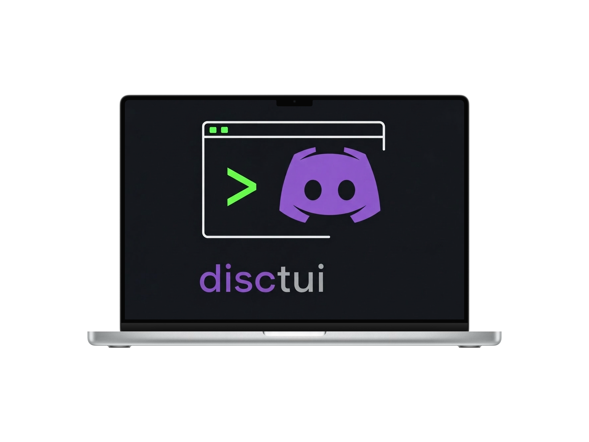
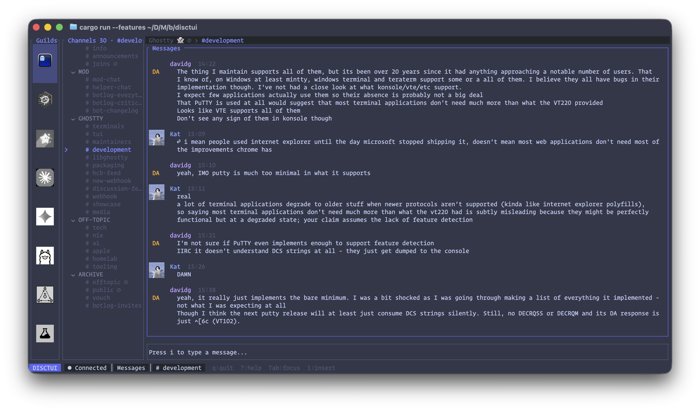

<p align="center">
  <a href="https://github.com/blacktop/disctui"></a>
  <!--<h1 align="center">disctui</h1>-->
  <h4><p align="center">A fast, minimal Discord TUI with AI-powered conversation summaries</p></h4>
  <p align="center">
    <a href="https://github.com/blacktop/disctui/actions" alt="Actions">
          </a>
    <a href="https://github.com/blacktop/disctui/releases/latest" alt="Downloads">
          </a>
    <a href="https://github.com/blacktop/disctui/releases" alt="GitHub Release">
          </a>
    <a href="http://doge.mit-license.org" alt="LICENSE">
          </a>
</p>
<br>



`disctui` is a terminal-first Discord client for reading guilds, DMs, and message history with a clean multi-pane layout, mute-aware unread state, inline media, and optional AI summaries.

> [!WARNING]
> `disctui` is an unofficial Discord user-token client.
> Using it may violate Discord's Terms of Service and can put your account at risk.
> Use a throwaway account and do not reuse your primary account.

> [!IMPORTANT]
> This is a user-token client, not a Discord bot.
> Browser sign-in only confirms which Discord account is yours. Reading and sending messages needs a Discord user token.

> [!TIP]
> For the best rendering experience, we recommend using [Ghostty](https://ghostty.org/).
> `disctui` should still look good in other modern terminals.

## Install

### Homebrew (macOS)

```sh
brew install --cask blacktop/tap/disctui
```

Releases up to 0.1.5 shipped as a formula. If you installed one of those, run `brew uninstall disctui` first.

### GitHub Releases

1. Download the latest release from [GitHub Releases](https://github.com/blacktop/disctui/releases).
2. Extract the archive.
3. Move the `disctui` binary into your `PATH`:

```sh
chmod +x disctui
mv disctui /usr/local/bin/
```

### Build From Source

```sh
git clone https://github.com/blacktop/disctui.git
cd disctui
cargo build --release --features experimental-discord
./target/release/disctui
```

### Dev Shortcuts

This repo includes a `justfile` for common workflows:

```sh
just build            # release binary with Discord support
just check            # fmt, clippy, and tests for both feature sets
just run digest --mock --no-ai
just package          # local release archives, nothing published
just bump             # bump the patch version, commit, push, and release
just release v0.2.0   # release the version already in Cargo.toml
```

Pushing a signed `vX.Y.Z` tag runs the release workflow, which builds both macOS architectures with GoReleaser and updates the Homebrew cask.

To act on a message, focus the message pane with `3` and select it with `Shift+J` or `Shift+K`. On macOS, press `c` to copy the full text or `o` to open a web link. If there are several links, use `j` or `k` and Enter to choose one. Use `Shift+C` to connect or reconnect.

## Auth

disctui has two kinds of sign-in, and they do different jobs.

| | What disctui gets | How |
| --- | --- | --- |
| Browser sign-in | Your account name and server list, including server icons | Discord's own authorization page |
| Message connection | Channels, DMs, sending, digests | A Discord user token |

Discord does not offer ordinary third-party apps a browser permission for reading arbitrary server messages or DMs, so the browser sign-in cannot replace the token.

### Browser sign-in

With no token saved, disctui opens the account screen. Press Enter and approve disctui in your default browser. Discord handles the login, and any captcha, on its own page, then hands back to disctui on `http://127.0.0.1:38547/callback`.

To use a saved Discord passkey, run `disctui --account` and press Enter. If Discord asks you to sign in, choose its passkey option. Approval opens the account and server list.

disctui asks for the `identify` and `guilds` permissions. If you signed in before server lists were added, press Enter when prompted and approve once more in your browser. Use `j` and `k` or the arrow keys to browse your servers. Opening one explains the message token needed for its channels.

disctui keeps the session in the macOS Keychain and renews it on later launches. `disctui --account` opens the account screen at any time, and `s` there signs out and revokes the grant.

### Message connection

On macOS, press Enter at the sign-in prompt to connect messages. disctui opens Discord's own login page in a native window beside the terminal and keeps rendering while you finish there, showing "Waiting for Discord", then "Verifying session", then "Connecting to messages". The window closes itself once Discord hands back a session, and the status reads connected only after the Gateway is ready. Esc closes the window and cancels. One window opens at a time, since two would race for the same Keychain entry.

The sign-in window runs as a child process of the running binary, because the macOS WebView needs the main thread that the terminal is already using. Nothing secret crosses that boundary: the child saves the validated session in the Keychain itself and reports only a progress word on its stdout.

`b` at the same prompt opens the browser account flow instead, which shows your name and servers but reads no channels or DMs. It is the only path that can use a Discord passkey, since a passkey needs Discord's own browser context.

disctui stores the session and its client metadata together in one macOS Keychain record. On upgrade, disctui migrates older entries after verifying the new record, so the first launch may still ask for access to both old items. Quit older disctui builds before signing in, because they can invalidate the session.

disctui looks for a Discord user token in this order:

1. `DISCTUI_TOKEN`
2. macOS Keychain entry `service=disctui`, `account=discord_session`
3. the sign-in prompt

At the prompt, press `t` to paste one. disctui saves it in the Keychain and connects.

You can also set the token for one session:

```sh
DISCTUI_TOKEN=... disctui
```

## Daily digest

In the TUI, press `1`, then `g` and Enter to open **◆ Digest** at the top of the server rail. Use `j` and `k` to browse, Enter to open the selected channel, `S` to regenerate the last 24 hours, or Esc to go back.

`disctui digest` prints a summary of your most active channels and exits, so you can catch up without opening the TUI or Discord.

```sh
disctui digest                          # last 24 hours, every server
disctui digest --since 3d --guild rust  # only servers whose name contains "rust"
disctui digest --out ~/digests/today.md # Markdown, from the extension
disctui digest --format json | jq '.needs_you'
```

The digest has four parts. "Mentions" lists the messages that mention you or reply to you with a ping. "Needs you" lists unanswered DMs and anything the AI flags as waiting on you. "Top channels" ranks channels per server by message count and gives each a one-line headline. "Quiet" names the servers with nothing new.

Channels are chosen from what Discord already sends at login, so a digest fetches history only for the channels it reports: three per server and fifteen overall by default (`--top`, `--limit`). Muted servers are included, since muting a server only silences its notifications. Individually muted channels are skipped.

To follow only some servers, list them in the config file. An entry is a server, or `Server #channel` for one channel, and names match as case-insensitive substrings:

```toml
digest_include = ["Rust Lang", "Tokio #announcements"]
```

A channel named this way is fetched even when muted. A server channel with unread mentions of you is always fetched too, whatever the whitelist, mutes, `--top` and `--limit` say. `--guild` replaces the whitelist for one run.

`--no-ai` skips the summaries and still ranks channels and flags mentions. `--mock` runs against built-in sample data, which is a quick way to see the output.

Without `--out`, the digest prints to the terminal and nothing is saved. To save every run, name the file in the config:

```toml
digest_out = "~/digests/today.md"
```

The extension picks the format: `.md` for Markdown, `.json` for JSON, anything else for text. `--format` overrides that, `--out FILE` writes somewhere else for one run, and `--out -` prints to the terminal. Each run replaces the file. `--mock` never writes to the configured file.

To get a digest every morning, run it from `cron` or a `launchd` agent with `digest_out` set or `--out`. It reads the token the same way the TUI does: `DISCTUI_TOKEN` first, then the Keychain.

## AI backends

Summaries work with a cloud model or a local one.

| `ai_backend` | Uses | Needs |
| --- | --- | --- |
| `auto` (default) | Claude if `ANTHROPIC_API_KEY` is set, otherwise the endpoint in `ai_base_url` | one of the two |
| `claude` | Anthropic API, `claude-haiku-5-5` by default | `ANTHROPIC_API_KEY` |
| `local` | Any OpenAI-compatible endpoint: LM Studio, Ollama, llama.cpp | `ai_base_url` (defaults to `http://localhost:1234/v1`) |
| `none` | Nothing; summaries are off | |

`ai_model` overrides the model for either backend. For a hosted OpenAI-compatible provider, set `ai_backend = "local"`, point `ai_base_url` at it, and put the key in `DISCTUI_AI_API_KEY`.

With a local backend, message text never leaves your machine.

## Rex

In [Rex](https://www.superlogical.com/rex), disctui adds three actions to the command palette:

| Action | What it does |
| --- | --- |
| `disctui_jump` | Search every channel and DM, then open the pick in disctui |
| `disctui_inbox` | List mentions and unanswered DMs, then open the pick |
| `disctui_digest` | Tick the servers to summarize, then read the digest in a split |

Install them once. From a checkout, one command does it:

```sh
rex/install.sh      # for the disctui already on your PATH
just install-rex    # or build and install disctui first
```

The script writes the actions file beside Rex's `init.lua`, loads it from there, and reloads Rex. It points the actions at the disctui it found, so they work when Rex's PATH differs from your shell's. Run it again after upgrading disctui.

The Homebrew cask does the upgrade half for you. When `~/.config/rex` exists, every `brew install` and `brew upgrade` rewrites `~/.config/rex/disctui.lua` for the new release. Homebrew's sandbox cannot reach Rex, so run `rex config reload` afterwards. The cask never edits `init.lua`; add the load line below once.

To do the same by hand:

```sh
disctui rex > ~/.config/rex/disctui.lua
```

Then add `dofile(os.getenv("HOME") .. "/.config/rex/disctui.lua")` to `~/.config/rex/init.lua` and run `rex config reload`. The file's header shows example key bindings. Picker actions load data in a temporary split, then show the picker for the original pane. Ctrl-C in the loading split cancels the command.

If disctui is already running, the pick opens in that pane; otherwise a new tab starts on the chosen channel. disctui also reports its state to the terminal (OSC 7501), so Rex shows when a digest is working or done and when the sign-in prompt is waiting.

## Scripting

These commands are what the Rex actions call, and they work from any script:

```sh
disctui channels --format json   # every channel, with unread and mention counts
disctui open <channel-id>        # switch a running disctui to that channel
disctui --open <channel-id>      # start the TUI on that channel
```

## Features

- Guild, channel, and Direct Messages navigation
- Virtual `Direct Messages` rail backed by Discord private channels
- Mute-aware unread behavior for guilds and channels
- Browser sign-in that confirms your account through Discord's own page
- Message sign-in in Discord's own login window, with macOS Keychain storage
- Inline image and avatar rendering when terminal support is available
- AI-powered unread summaries for active conversations
- Headless daily digest in text, Markdown, or JSON
- Cloud or local AI backends
- Rex command palette actions for channel search, inbox, and digests
- Ghostty-friendly loading feedback for visible async refreshes

## Configuration

Config file search order:

- macOS: `~/Library/Application Support/disctui/config.toml`
- XDG-style fallback: `~/.config/disctui/config.toml`

Start from [`config.toml.example`](./config.toml.example).

Config keys:

- `tick_rate_ms`
- `mouse`
- `ai_backend`
- `ai_base_url`
- `ai_model`
- `ai_api_key`
- `digest_include`
- `digest_out`

Any key can also be set from the environment with a `DISCTUI_` prefix, for example `DISCTUI_AI_BACKEND=local`. For a digest list, separate entries with commas, as in `DISCTUI_DIGEST_INCLUDE="Rust Lang,Tokio #announcements"`.

## Logging

Debug logging is off by default.

Enable it for one session:

```sh
disctui --debug
```

Logs are written to:

- macOS: `~/Library/Application Support/disctui/disctui.log`

Headless commands (`digest`, `channels`, `open`) print warnings to stderr and leave that file alone.

State is stored in:

- macOS cache DB: `~/Library/Caches/disctui/disctui.db`

## Limitations

- This project uses a Discord user token and is not an officially supported client.
- Release binaries always include Discord support via the `experimental-discord` feature.
- The sign-in prompt currently assumes macOS Keychain support for persistence.
- Browser sign-in cannot read messages; Discord does not offer ordinary apps that permission.
- Local read-state clearing for DMs still depends on Discord providing a usable `last_message_id`.

## License

MIT. See [LICENSE](./LICENSE).
